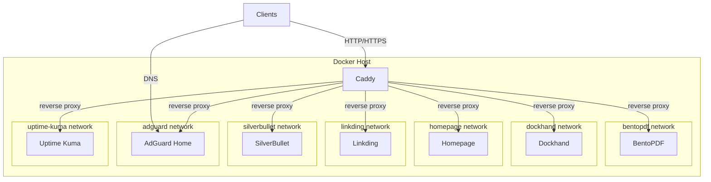

# self-hosted

Dictionary of my self-hosted apps.

## Applications

- [AdGuard Home](https://adguard.com/en/welcome.html) - DNS filtering for the homelab
- [BentoPDF](https://www.bentopdf.com/docs/) - PDF tools
- [Caddy](https://caddyserver.com/) - Web server and reverse proxy
- [Dockhand](https://dockhand.pro/) - Manage Docker stacks and containers
- [Homepage](https://gethomepage.dev/) - Homelab dashboard
- [Linkding](https://linkding.link/) - Bookmark manager
- [SilverBullet](https://silverbullet.md/) - Personal knowledge base
- [Uptime Kuma](https://uptime.kuma.pet/) - Service availability monitoring

## Architecture

